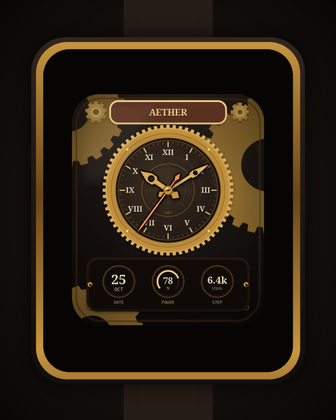
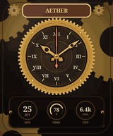

# Steampunk RW5A

Mặt đồng hồ **steampunk** 320 × 385 cho **Redmi Watch 5 Active**, bo góc theo
viền máy, sinh 100% bằng code và phát hành tự động qua GitHub Actions.

[](https://github.com/khahdihdz/steampunk-watchface-rw5a/actions/workflows/ci.yml)
[](https://github.com/khahdihdz/steampunk-watchface-rw5a/actions/workflows/release.yml)
[](LICENSE)





## Đọc trước: giới hạn của thiết bị

Redmi Watch 5 Active chạy **HyperOS**, **không phải Wear OS** và **không có SDK
mặt đồng hồ công khai**. Vì vậy repo này **không** tạo APK và **không** cài được
bằng ADB. Thứ được phát hành là bộ asset thật, dùng được theo hai cách:

| Cách | Cần gì | Kết quả |
|---|---|---|
| **Ảnh mặt đồng hồ** | Mi Fitness trên điện thoại | Mặt tĩnh, dùng được ngay trong 2 phút |
| **Layer + layout.json** | Mi Watch Face Editor | Mặt động, kim chạy, có thể chỉnh |

Nói cách khác: phần "deploy GitHub + release build bằng Actions" là **thật** —
chỉ có điều artefact là gói thiết kế đã render, không phải APK.

## Nội dung gói release

```
photo/face.png          320x385 RGB — dùng cho tính năng ảnh mặt đồng hồ
photo/face_rounded.png  bản đã bo góc 46px (alpha ngoài góc = 0)
photo/face_night.png    bản dịu sáng cho ban đêm
layers/*.png            9 layer rời, cùng hệ toạ độ 320x385
layout.json             toạ độ, tâm xoay, thứ tự z, chu kỳ xoay
INSTALL.txt             hướng dẫn nhanh
```

## Dùng ngay (mặt tĩnh)

1. Tải `steampunk-rw5a-<version>.zip` ở trang
   [Releases](../../releases), giải nén, copy `photo/face.png` sang điện thoại.
2. Mở **Mi Fitness** → **Thiết bị** → **Mặt đồng hồ** → **Ảnh** → chọn ảnh.
3. Phóng to để ảnh phủ kín màn hình rồi lưu.

## Dựng bản động (kim chạy)

Xem [docs/mi-watch-face-editor.md](docs/mi-watch-face-editor.md). Tóm tắt: import
9 layer theo đúng thứ tự z, đặt tâm xoay của 3 kim là **(160, 160)**, chu kỳ
12h / 60m / 60s.

## Cấu trúc repo

```
assets/layout.json         nguồn sự thật cho toạ độ + layer + tâm xoay
assets/palette.json        bảng màu (9 màu)
scripts/steampunk.py       thư viện vẽ: Canvas supersampled 3x, gradient, gear…
scripts/generate.py        render ảnh phẳng, layer, mock-up, GIF
scripts/validate.py        61 kiểm tra ràng buộc thiết bị/thiết kế
scripts/build.py           đóng gói zip tái lập + manifest + SHA256SUMS
docs/design-spec.md        đặc tả thiết kế chi tiết
PROMPT.md                  prompt đầy đủ để tái tạo dự án bằng AI
```

## Build tại máy

```bash
python -m venv .venv && . .venv/bin/activate
pip install -r requirements.txt
sudo apt install fonts-noto-core fonts-dejavu-core   # hoặc fonts-dejavu-core

make package VERSION=1.0.0
```

Kết quả trong `dist/`:

```
dist/steampunk-rw5a-1.0.0.zip
dist/manifest.json
dist/SHA256SUMS.txt
dist/preview/preview.png
dist/preview/rotation.gif
```

Xem trước nhanh:

```bash
make preview      # dist/preview/preview.png
make check        # render + 61 kiểm tra
```

## Phát hành

```bash
git tag v1.0.0 && git push origin v1.0.0
```

`release.yml` sẽ build, xác minh checksum và tạo GitHub Release kèm zip,
manifest, preview. Có thể chạy tay qua **Actions → Release → Run workflow**.

Build **tái lập được**: `SOURCE_DATE_EPOCH` được lấy từ ngày commit, zip ghi
timestamp cố định, nên hai lần build cho ra file giống nhau từng byte — CI kiểm
tra điều này ở mỗi lần push.

## Thiết kế

- Bánh răng đồng thau 64 răng ở vành mâm, thêm bánh răng mờ ở nền.
- Kim kiểu Breguet có vòng rỗng gần mũi, đối trọng phía sau, bóng đổ 2 px.
- Mặt số gang oxy hoá, số La Mã màu kem, vạch phút đồng thau, kim giây cam.
- Đinh tán 4 góc, vít trên vành, vết verdigris, vignette, vân xước ly tâm.
- Mọi nội dung nằm trong vùng an toàn 14 px, bo góc 46 px.

Chi tiết token, bảng layer và lý do từng lựa chọn: [docs/design-spec.md](docs/design-spec.md).

## Phụ thuộc

- Python ≥ 3.10, Pillow ≥ 10.4
- Font: Noto Serif Bold / DejaVu (có thể ghi đè bằng `WATCHFACE_FONT_SERIF`,
  `WATCHFACE_FONT_MONO`)

## Giấy phép

MIT — xem [LICENSE](LICENSE). Thiết kế gốc, không dùng asset bên thứ ba.
